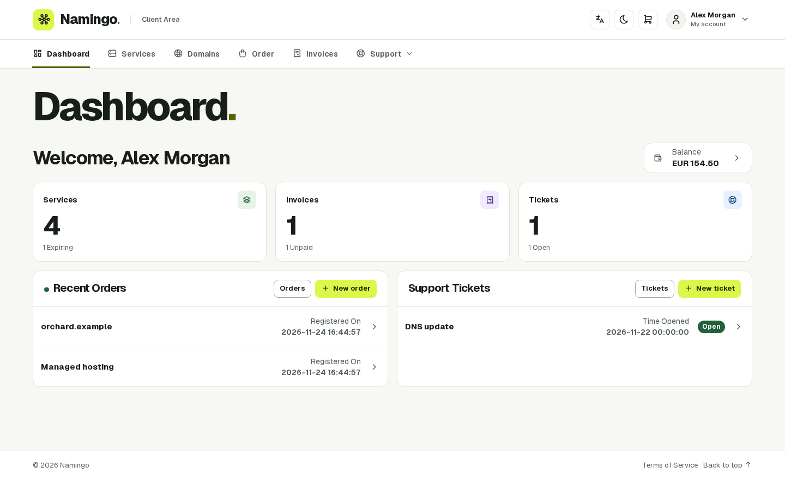

# Kovil Theme for FOSSBilling

[](https://github.com/vshymanskyy/StandWithUkraine/blob/main/docs/README.md)

[](https://github.com/vshymanskyy/StandWithUkraine/blob/main/docs/README.md)

## Overview

Kovil is a client-area theme for FOSSBilling 0.8.9, based on Tide 1.2.18. It uses the high-contrast Namingo dashboard design, including the horizontal navigation, bold headings, metric cards, and persistent light and dark modes. The package includes the required Tabler Icons webfont glyphs and the Geist typeface.

<p align="center">
  
</p>

## Compatibility

- Kovil 1.0.0 → FOSSBilling 0.8.9

We strongly recommend upgrading to the latest version of FOSSBilling.

## Installation

```bash
TMP=$(mktemp -d)
git clone --branch v1.0.0 --depth 1 https://github.com/getnamingo/kovil.git "$TMP/kovil"
mkdir -p /var/www/themes/kovil
cp -a "$TMP/kovil/." /var/www/themes/kovil/
rm -rf /var/www/themes/kovil/.git
chown -R www-data:www-data /var/www/themes/kovil
find /var/www/themes/kovil -type d -exec chmod 755 {} +
find /var/www/themes/kovil -type f -exec chmod 644 {} +
rm -rf "$TMP"
```

- In the FOSSBilling admin panel, go to `Settings -> Themes` and select `Kovil` as the default theme.

## Upgrade

```bash
TMP=$(mktemp -d)
git clone --branch v1.0.0 --depth 1 https://github.com/getnamingo/kovil.git "$TMP/kovil"
cp -a /var/www/themes/kovil/config/settings_data.json "$TMP/settings_data.json"
cp -a "$TMP/kovil/." /var/www/themes/kovil/
cp -a "$TMP/settings_data.json" /var/www/themes/kovil/config/settings_data.json
rm -rf /var/www/themes/kovil/.git
chown -R www-data:www-data /var/www/themes/kovil
find /var/www/themes/kovil -type d -exec chmod 755 {} +
find /var/www/themes/kovil -type f -exec chmod 644 {} +
rm -rf "$TMP"
```

## Theme Customization

- Edit `assets/css/kovil.css` to change the design tokens, spacing, and component styles.
- Place template overrides in `html_custom/`. To add your own stylesheet, put it in `assets/custom/` and load it through `html_custom/custom/head.extra.twig`.
- Kovils’s dashboard hooks are available as `custom/dashboard.top.twig`, `custom/dashboard.widgets.twig`, and `custom/dashboard.bottom.twig`. Place overrides under `html_custom/custom/`.
- The client-area markup retains common FOSSBilling classes such as `card`, `btn`, `form-control`, and `table`, all styled in Kovil. If a third-party widget uses Bootstrap behavior, adapt its controls to Kovil’s `data-tab`, `data-collapse`, or `data-open-dialog` attributes. Use a native `<dialog>` for dialog content.

## Support

Your feedback and inquiries are invaluable to Namingo's evolutionary journey. If you need support, have questions, or want to contribute your thoughts:

- **Email**: Feel free to reach out directly at [help@namingo.org](mailto:help@namingo.org).

- **Discord**: Or chat with us on our [Discord](https://discord.gg/97R9VCrWgc) channel.
  
- **GitHub Issues**: For bug reports or feature requests, please use the [Issues](https://github.com/getpinga/kovil/issues) section of our GitHub repository.

We appreciate your involvement and patience as Namingo continues to grow and adapt.

## Support This Project

If you find Kovil useful, consider donating:

- [Donate via Stripe](https://donate.stripe.com/7sI2aI4jV3Offn28ww)
- BTC: `bc1q9jhxjlnzv0x4wzxfp8xzc6w289ewggtds54uqa`
- ETH: `0x330c1b148368EE4B8756B176f1766d52132f0Ea8`

## Licensing

Kovil is licensed under the Apache License, Version 2.0.

Kovil adapts templates from [Tide 1.2.18](https://github.com/getnamingo/tide/tree/v1.2.18) and [FOSSBilling 0.8.9](https://github.com/FOSSBilling/FOSSBilling/tree/0.8.9). The package preserves their license notices and includes licenses for the bundled fonts and libraries.